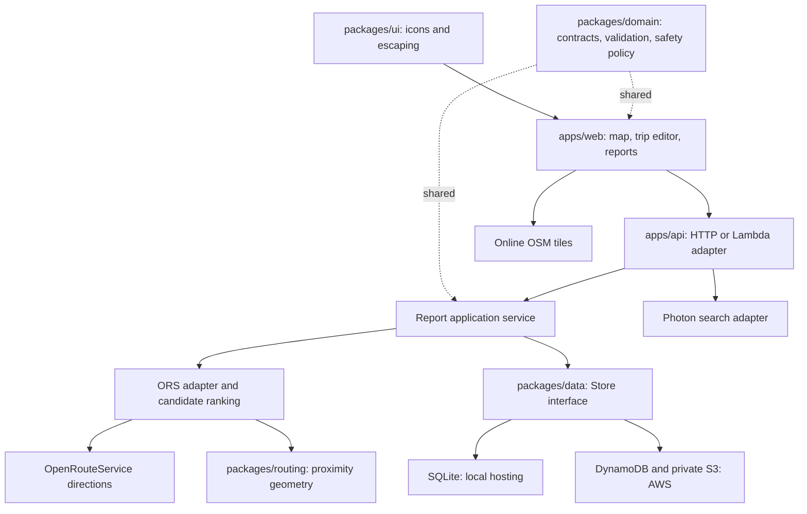
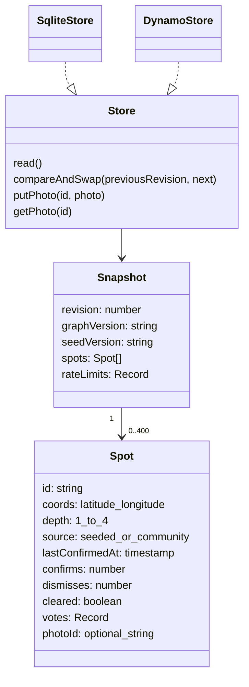
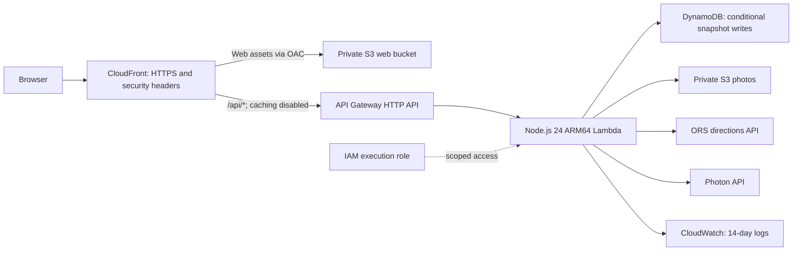

# PaaniPath

Waterlogging-aware trip planning for Delhi NCR: **real online maps, real API directions, and transparent vehicle-dependent flood-exposure comparisons**.

PaaniPath helps road users compare routes against reported waterlogging instead of considering travel time alone. It covers Delhi, Gurugram/Gurgaon, Noida, Greater Noida, Ghaziabad, Faridabad and saved outer-NCR locations. Its white/light-blue interface supports searchable destinations, map selection and trips with up to two intermediate stops.

> Never enter standing water. Reports may be incomplete or outdated. Vehicle thresholds, approximate flood buffers and a recommended route do not establish that a road is safe.

## Explore the project

- [Data structures and algorithms](docs/ALGORITHMS.md): implemented algorithms, pseudocode, complexity, invariants, worked example, research context and evaluator walkthrough.
- [API contract](docs/API.md): endpoints, requests, responses, errors and session behavior.
- [Engineering guide](docs/ENGINEERING.md): monorepo boundaries, tests, security, AWS integration, seed provenance and design decisions.

## What it does

| Capability | Implementation |
| --- | --- |
| Real street map | Online OpenStreetMap raster tiles, visible attribution and Web Mercator overlays |
| Address search | Photon geocoding with NCR bounds, saved-location suggestions and map-point selection |
| Multi-stop trips | 2–4 locations; add, remove, reorder or reverse; optionally compare both intermediate-stop orders |
| Flood-aware comparison | Provider baselines and polygon-avoidance candidates, exposure scoring and a user-selected detour budget |
| Vehicle assumptions | Scooter, motorbike, car, auto and bus depth classifications; configurable marginal/damaging thresholds |
| Community observations | Depth reports, proximity-based duplicate merging, nearby independent votes, freshness and optional photos |
| Map focus | Selecting a result centres the map; returned/selected routes fit their complete geometry |
| Responsive experience | Desktop/mobile layouts, keyboard place selection, touch map interactions and visible error states |
| PWA shell | App-asset caching and a bounded pending-report queue; no offline maps or routing |

There are **no road datasets, Overpass chunk downloads, Python importers, local routing graphs or mock-route fallback**. OpenRouteService (ORS) supplies all road directions. Without a key, the map/reports can load but routing returns `ROUTING_KEY_REQUIRED`.

## Quick start

Requires **Node.js 24+**, npm, internet access and your own [OpenRouteService API key](https://openrouteservice.org/).

```powershell
npm ci --ignore-scripts
Copy-Item .env.example .env
```

Only copy the example if `.env` does not already exist; preserve existing settings and storage paths. Open `.env` privately and set `ORS_API_KEY` to your key. Then:

```powershell
npm run build
npm start
```

Open **http://localhost:3000**. For rebuild/watch development, use `npm run dev`. On POSIX shells, use `cp .env.example .env` for the copy step.

### Configuration

| Variable | Local example / purpose |
| --- | --- |
| `ORS_API_KEY` | Required server-only directions key; never sent to the browser |
| `ORS_URL` | Trusted directions base URL, default `https://api.openrouteservice.org/v2/directions` |
| `PHOTON_URL` | Geocoding endpoint, default `https://photon.komoot.io/api/` |
| `PORT`, `HOST` | `3000`, `127.0.0.1` locally |
| `STORE` | `sqlite` locally; `dynamodb` in Lambda |
| `DATA_DIR` | `.data/api-seeded` in the example; keep stable to retain local reports/photos/session secret |
| `SEED_MODE` | `true` for labelled demo observations; `false` for community-only visibility/routing |
| `DEMO_MODE` | `false` normally; explicitly enables labelled seed-reset controls when true |
| `SESSION_SECRET` | Shared stable signing secret required in AWS (32+ characters); generated/persisted locally if absent |
| `TABLE_NAME`, `PHOTO_BUCKET`, `AWS_REGION` | AWS storage configuration populated by the SAM template/runtime |

`.env`, `.data`, generated builds, credentials and machine-specific configuration are excluded from Git. Local SQLite records are not automatically migrated to AWS.

### Demo data is not live incident data

Seed mode initializes a catalogue of **320 simulated observations**: 224 general NCR scenarios and 96 near 24 historically reported Gurugram hotspots. Research links establish historical locations—not present-day floods, measured depths or exact road coordinates. Pins, ages and depths are approximate/simulated and can influence routing. Existing stores receive a versioned seed upgrade preserving community records and matching seed votes/freshness, subject to capacity. See [provenance and upgrade behavior](docs/ENGINEERING.md#seed-data-and-provenance).

## Architecture

### Application responsibilities



The API boundary validates untrusted requests. A reusable service coordinates reports and revisioned writes; storage adapters implement the same interface. Hosted-routing and geocoding transports are injectable for isolated tests. Shared domain types prevent client/server contract drift, while runtime validation protects the network boundary.

### Route request lifecycle

```mermaid
sequenceDiagram
  participant U as Browser
  participant A as API / domain validation
  participant S as Report store
  participant P as Candidate planner
  participant R as OpenRouteService
  U->>A: 2–4 stops, vehicle, detour factor
  A->>S: Read consistent report revision
  A->>P: Validated trip and visible observations
  P->>P: Classify active reports; enumerate 1–2 orders
  P->>R: Fastest baseline for each order
  R-->>P: Provider geometry and travel estimates
  P->>R: Avoidance directions using approximate flood polygons
  R-->>P: Candidate geometry or explicit no-route
  P->>P: Score exposure; enforce detour; deduplicate; rank
  P-->>A: Up to 3 routes, revision, limitations
  A-->>U: Recommendation and fastest baseline
  U->>U: Fit full route geometry on map
```

Credential/quota/timeout/malformed-response failures return actionable errors, never invented routes. Only documented avoidance no-route outcomes permit retaining baseline routes with an explicit warning.

### Report model and writes



Updates use optimistic revision checks and up to five retries to avoid silently losing simultaneous edits. A signed opaque session provides an anonymous actor identity; it is not account authentication or a strong defense against identity farming.

## AWS integration

[infra/template.json](infra/template.json) declares the serverless pilot stack through AWS SAM/CloudFormation. No AWS resources are required for local use.



| AWS service | How this project uses it |
| --- | --- |
| CloudFront | Same-origin website/API access, web caching, API cache TTLs zero, HTTPS and response security headers |
| S3 web bucket | Compiled `dist/web` assets; private origin access control, no public website bucket |
| API Gateway | HTTP API `$default` stage; `ANY /api/{proxy+}` to Lambda, rate/burst throttling |
| Lambda | Shared application through `apps/api/src/lambda.ts`; 2,048 MB, 25 s timeout, reserved concurrency 5 |
| DynamoDB | On-demand encrypted table, consistent reads and conditional writes; PITR and retention policies |
| S3 photo bucket | Server-mediated JPEG/PNG storage under `photos/`; private, encrypted, 30-day expiration |
| IAM | Function-scoped DynamoDB item access, photo-prefix object access and logging permissions |
| CloudWatch | Lambda logs and operational diagnosis; alarms require separate configuration |

AWS runtime credentials come from the Lambda execution role. The storage adapter signs requests with AWS Signature V4 and does not ship AWS credentials to the browser. `SessionSecret` and `OrsApiKey` are `NoEcho` parameters mapped to Lambda environment variables; a managed secret lifecycle must be configured separately. Secrets Manager and custom-domain certificates are **not resources in the current template**.

Deployment has two stages: build/package/deploy the template and Lambda artifact, then upload `dist/web` to the output web bucket and invalidate CloudFront. The template outputs `WebsiteUrl`, `WebBucketName`, `DistributionId` and `ApiUrl`. Public API access, regional quotas, provider connectivity and storage must be acceptance-tested before launch. The detailed account-specific deployment runbook is intentionally excluded from version control.

## Routing and algorithms

The application implements **bounded candidate comparison**, not a local Dijkstra/A* road-network engine:

1. Validate distinct stops; keep origin/destination fixed and compare at most two intermediate orders.
2. Classify active reports by vehicle thresholds and one-hour freshness.
3. Build approximate 60 m half-width polygons for damaging, marginal and stale reports.
4. Request provider baselines and avoidance candidates.
5. Count each observation once if within 85 m of any candidate segment.
6. Keep candidates within `fastestReturnedBaseline × detourFactor`; rank by damaging count, caution count, worst depth, then estimated duration.
7. Deduplicate identical geometry; return the best two candidates plus the baseline if not already represented.

The fastest baseline means fastest **returned** provider baseline, not a proved globally fastest route. `stats.optimal` is always `false`. Exact evaluation of two intermediate orders is not a general traveling-salesperson solver. The algorithm writeup includes a worked example, complexity bounds, data-structure choices and proof boundaries: [ALGORITHMS.md](docs/ALGORITHMS.md).

ORS car access rules approximate scooter/motorbike/auto requests; bus requests use its HGV bus profile without measured dimensions. Travel estimates are not live traffic. Public-hosted avoidance routing is limited to 150 km under the current [provider restrictions](https://openrouteservice.org/restrictions/); increasing the viewport alone cannot enable national flood-aware trips.

## Repository structure

```text
PaaniPath/
├── apps/
│   ├── api/                 Application, sessions, providers, local/Lambda adapters
│   └── web/                 Map, trip editor, search, reporting, styles, PWA shell
├── packages/
│   ├── domain/              Types, input validation, safety/freshness policy
│   ├── data/                NCR seeds, Store interface, SQLite/DynamoDB/S3 adapters
│   ├── routing/             Haversine and point-to-segment geometry
│   └── ui/                  Reusable SVG icons and safe HTML helpers
├── tests/                   Domain, provider, storage, map, UI and API tests
├── scripts/                 Portable build, lint, testing and validation tools
├── infra/                   AWS SAM template
├── docs/                    Algorithms, API and Engineering (three tracked docs)
├── .github/workflows/       Linux/Windows quality gates
├── .env.example             Blank-key configuration example
├── Dockerfile               Non-root local/container hosting
└── package.json             npm workspaces and project commands
```

`dist/`, `node_modules/`, `.data/` and the local deployment runbook are intentionally untracked. No obsolete UI/mockup/problem-statement/backend folder is required by the build.

## Quality and verification

```powershell
npm run check
npm run test:http
```

| Command | What it verifies |
| --- | --- |
| `npm run typecheck` | Strict TypeScript, unchecked indexing, optional-property accuracy, unused code checks |
| `npm run lint` | AST rules: no explicit `any`, non-null assertions, type suppressions or debugger; function complexity limit 25 |
| `npm test` | Unit/contract tests with deterministic transports and clocks |
| `npm run build` | Portable ESM compilation, workspace alias resolution, web assets and Lambda artifact |
| `npm run check` | Types, lint, unit tests, build, structural infrastructure and tracked-documentation validation |
| `npm run test:http` | Isolated real local HTTP integration with a temporary SQLite store and mocked ORS transport |
| `npm run test:e2e` | Running-server smoke test; requires configured real routing and consumes provider quota |

GitHub Actions runs automated checks on Linux and Windows using Node 24. Mocks exist in tests, not production routing. Structural AWS checks are not full SAM schema validation or cloud acceptance. No live provider, cloud deployment or browser/device acceptance is inferred from unit tests. See [verification details](docs/ENGINEERING.md#testing-and-quality-gates).

For a deployed smoke test, set `TEST_BASE_URL` to its HTTPS hostname before `npm run test:e2e`. Avoid modifying real incident data during acceptance tests; use staging for report/photo submissions.

## Security, privacy and scale boundaries

- ORS receives stops and avoidance polygons; Photon receives search text; tile requests reveal the viewed map area to the tile service.
- Reports/photos are stored; route histories are not persisted by the application. The 30-second per-process route cache is transient.
- Mutations require JSON and `X-PaaniPath: 1`; signed cookies, validation, bounded payloads and nearby-vote checks reduce accidental misuse but do not replace production authentication/moderation.
- Current report storage is capped at 400 observations; DynamoDB payloads are limited below 350,000 bytes. This single-snapshot pilot must be partitioned for larger deployments.
- Provider calls have deadlines, bounded comparison concurrency and per-process budgets/caches. Multiple Lambda instances require a durable shared quota limiter.
- Point buffers may block parallel roads or bridges; proximity scoring cannot distinguish elevation/road-level topology. Missing reports mean unknown conditions, not dry roads.
- Public tile/geocoding services provide no application SLA. Respect [OSM tile usage policy](https://operations.osmfoundation.org/policies/tiles/) and provision appropriate production services.

## Contributing and release hygiene

Use focused conventional commits such as `feat(api): ...`, `fix(routing): ...`, `test(storage): ...` and `docs(project): ...`. Run both quality commands before proposing changes. Include tests for behavioral changes and update the relevant one of the three docs. Keep unrelated modifications separate; never commit `.env`, reports/photos, private keys, generated builds or account-specific deployment settings.

This repository does not currently declare an open-source license. Do not infer redistribution permission from public hosting; the owner should choose a license deliberately.
