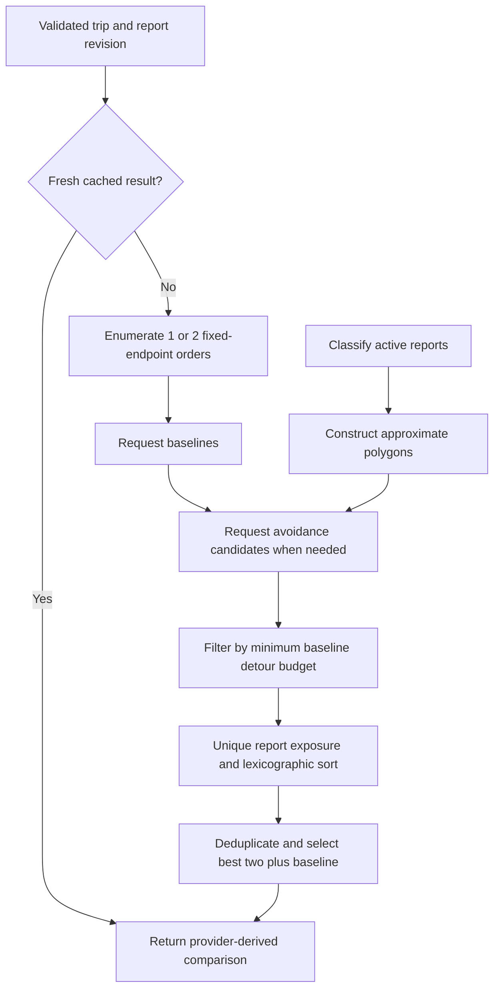
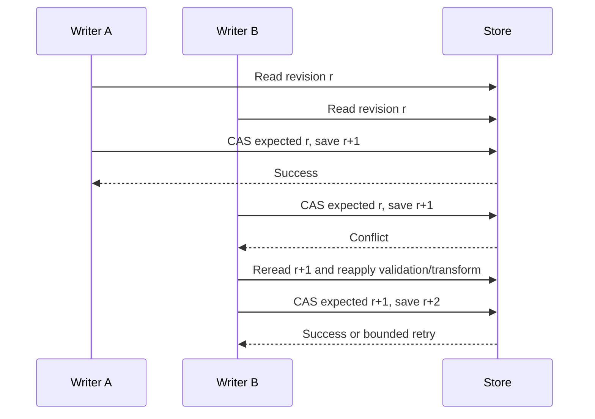

# Data structures and algorithms

This is a source-grounded evaluation writeup for PaaniPath. Start with [the README](../README.md) for product context and architecture. The implemented contribution is the report-aware orchestration, geometry, ranking, bounded caches and concurrent persistence around a hosted road-directions service—not a proprietary maps engine.

## 1. Problem formulation

Input: 2–4 distinct locations, a vehicle profile, detour factor `f ∈ [1,3]`, an intermediate-order flag, a report snapshot and its revision/time. Output: up to three provider-derived routes with exposure scores, recommended/fastest flags and explicit limitations.

We prefer fewer damaging exposures before caution exposures, worst observed depth and estimated travel time. A candidate must satisfy `T(route) ≤ f × T0 + 0.001`, where `T0` is the minimum returned baseline duration in seconds. The tolerance addresses floating-point comparisons; it is not an additional travel allowance.

We optimize over **returned candidates only**, not every path in the road network. Reports and vehicle limits are uncertain assumptions. `optimal=false` communicates this boundary.

## 2. Implemented data structures

| Structure | Location | Reason and behavior |
| --- | --- | --- |
| Readonly coordinate tuple `[lat,lng]` | `packages/domain/src/types.ts` | Stable app convention; convert explicitly to GeoJSON/ORS `[lng,lat]` at boundaries |
| Ordered `Place[]` | Route request / trip editor | Preserves waypoint order; 2–4 entries; origin and destination fixed during optimization |
| Polyline `Coordinates[]` | Provider `RouteOption.geometry` | Sequential segment traversal; validated 2–200,000 points per returned feature |
| Report `Spot[]` | `Snapshot.spots` | Simple bounded scans and predictable serialization; maximum 400 reports |
| Four-component score | `RouteOption.score` | Transparent lexicographic comparison without arbitrary weighted-unit conversion |
| GeoJSON MultiPolygon | `avoidancePolygons` | One closed square per avoided report; consumable by hosted directions |
| `Map<string, cacheEntry>` | `ApiRouting` | Maximum 64 entries, 30-second success TTL; insertion-order eviction, **not LRU** |
| Timestamp array | `ApiRouting.calls` | Sliding 60-second per-process request budget, maximum 30 calls |
| Cache and promise maps | `PlaceSearch` | Maximum 200 search-cache keys; identical in-flight requests share one promise |
| `Set<string>` | Search parsing/merging | Deduplicates names and merged place-result identities |
| `Record<actor,vote>` | Each report | Prevents a second vote from the same anonymous actor |
| `Record<actor:action,timestamps>` | Snapshot rate limits | Persisted mutation budgets, pruned on mutation |
| Revision number / CAS | Store interface | Detects conflicting writers; SQLite conditional UPDATE and DynamoDB conditional PutItem |
| Pending-report array | Browser localStorage | At most 10 unsent reports, replayed sequentially |

No adjacency list, edge-cost heap, union-find, local road graph or road-network spatial index remains in this implementation. `edgeIds=[]`, `expanded=0`, and compatibility graph metadata are not evidence of local graph search. The public response omits private reporter IDs and vote maps.

## 3. Candidate-planning algorithm

Source: [api-routing.ts](../apps/api/src/api-routing.ts).

```text
plan(trip, snapshot, now):
    validate key and pairwise stop distances > 10 metres
    active := reports that are neither cleared nor archived
    classify active reports for the selected vehicle at now
    key := serialize(trip, revision, each active report's id/verdict/depth)
    if an unexpired cached response exists: return it
    reject if two comparisons are already active in this process
    increment active comparison count
    try:
        orders := [original order]
        if four stops and optimization enabled:
            append [0, 2, 1, 3]
        baselines := provider fastest directions for each order
        fastest := baseline with minimum estimated duration
        avoided := active damaging, marginal or stale reports
        detours := provider avoidance directions for each order if avoided nonempty
        only documented avoidance NO_ROUTE may omit a detour with a warning
        budget := fastest.duration * detourFactor
        candidates := successful routes within budget + tolerance
        score each candidate against all active reports
        sort by (damaging, caution, worstDepth, duration)
        deduplicate exactly identical geometry
        selected := first two unique candidates
        append scored fastest baseline if its geometry is absent
        mark first as recommended; attach warnings and revision
        cache successful response for 30 seconds
        return selected
    finally:
        decrement active comparison count
```



Baseline calls within a phase run concurrently; avoidance calls run after baselines complete. At most four upstream calls are made per comparison: two baselines and two avoidance queries. With fewer than four stops, or order optimization disabled, only one order is considered. With no relevant avoidance reports, the second phase makes no calls.

### Stop-order enumeration

For four locations `[O,A,B,D]`, the only fixed-endpoint permutations of two intermediate stops are `[O,A,B,D]` and `[O,B,A,D]`. Enumerating both is complete **for intermediate-stop permutations in this bounded input**, but only one baseline and one avoidance result per order are requested. It does not enumerate all network paths or solve arbitrary-size TSP. Pairwise distinctness takes `O(k²)` Haversine checks, with `k ≤ 4`.

## 4. Classification and flood buffers

Source: [policy.ts](../packages/domain/src/policy.ts).

Classification checks cleared state first, then staleness (`now - lastConfirmedAt ≥ 1 hour`), then damaging and marginal thresholds; otherwise it returns passable. The routing planner already excludes cleared/archived reports. Thus a stale report remains cautious regardless of its nominal depth, rather than being interpreted as evidence of a clear road.

Default scooter/motorbike/auto thresholds are marginal level 2 and damaging level 3; car/bus defaults are 3 and 4. Levels are qualitative observations (1–4), not measured centimetres or verified manufacturer capabilities. Input validation enforces `marginal ≤ damaging`.

For report `(lat,lng)`, buffer half-width in degrees is:

```text
dy = 60 / 111320
dx = dy / max(0.01, cos(lat * π / 180))
ring = [(lng-dx,lat-dy), (lng+dx,lat-dy),
        (lng+dx,lat+dy), (lng-dx,lat+dy), firstPoint]
```

The result is a MultiPolygon in GeoJSON order. Buffer construction is `O(n)` time/space. These ~120 m-wide squares are approximate uncertainty zones, not surveyed flood extents, circles or road-level closures. A nearby bridge/parallel carriageway can be blocked incorrectly. The 85 m exposure threshold differs from the 60 m square half-width, so avoidance and scoring are not equivalent predicates.

## 5. Geographic proximity and exposure scoring

Source: [geometry.ts](../packages/routing/src/geometry.ts).

**Haversine:** point-to-point great-circle distance uses Earth radius 6,371,008.8 m. The intermediate value is clamped before `asin` to avoid floating-point values slightly above one. It supports distinct-stop checks, duplicate-report detection and nearby-vote validation.

**Point-to-segment:** translate a short route segment relative to the report, scale longitude by `cos(reportLatitude)`, and use a local tangent-plane approximation. For vectors `a`, `b`, `d=b-a`:

```text
t = 0 if dot(d,d)=0 else clamp(-dot(a,d)/dot(d,d), 0, 1)
distance = norm(a + t*d) * π/180 * EarthRadius
```

Clamping handles the segment endpoints; zero-length segments are safe. This is an approximation for short local geometry segments, not exact spherical point-to-geodesic distance or road map matching.

For each candidate, a report is a hit if **any** segment is within 85 m. Filtering reports once means a report near many segments or revisited legs still contributes only once:

```text
damaging = count(hits classified damaging)
caution = count(hits classified marginal or stale)
worstDepth = max(0, depths of all hits)
duration = provider estimate
```

Passable reports still contribute to `worstDepth` and `spotIds`, not damaging/caution counts. The exposure list is unique by report traversal, assuming snapshot report IDs remain unique. No independent measured flood probability is calculated.

### Ranking example

Assume the fastest baseline is 600 s and detour factor is 1.5: budget = 900 s.

| Candidate | Damaging | Caution | Worst depth | Duration | Result |
| --- | --- | --- | --- | --- | --- |
| A: baseline | 1 | 0 | 4 | 600 s | Eligible; retained for comparison |
| B: avoidance | 0 | 1 | 3 | 840 s | Recommended among eligible candidates |
| C: other order | 0 | 2 | 2 | 780 s | Eligible, ranks after B despite being quicker |
| D: long avoidance | 0 | 0 | 0 | 960 s | Rejected before ranking: over budget |

The rank tuple prioritizes fewer damaging reports over all other dimensions, then fewer caution reports. B wins over C; D cannot win because it violates the user's time allowance. Returned baseline A is not labelled safe. This is an illustrative arithmetic example, not a live provider result.

## 6. Complexity and bounds

Let `k` be stops (≤4), `o` orders (≤2), `c` returned candidates (≤4), `n` active reports (≤400), `s` maximum geometry segments per candidate (≤199,999), and `L` bytes of a serialized geometry. Let `q` be search results and `p` saved places.

| Operation | Worst-case local time | Additional space / caveat |
| --- | --- | --- |
| Stop distinctness | `O(k²)` | `O(1)` |
| Classification/buffers | `O(n)` | `O(n)` |
| Provider parsing | `O(c*s)` | `O(c*s)` stored geometry; network latency outside local complexity |
| Exposure scoring | `O(c*n*s)` | `O(n)` hit list per candidate; segment traversal short-circuits on first hit |
| Sort | `O(c log c)` | Sort implementation overhead; c is small |
| Exact geometry deduplication | `O(c²*L)` | Repeated JSON serialization, not an O(1) hash lookup |
| Cache key construction | `O(requestBytes+n)` | Full serialized request/classification key |
| Sliding provider budget | `O(b)` | `O(b)` timestamps, `b ≤ 30` within the live window |
| Search local scan | `O(p*queryTerms*nameLength)` | Up to 8 saved results |
| Search-result dedup | Expected `O(q)` membership operations plus string construction | `O(q)` keys; hash-map complexity is expected, not a universal strict bound |
| CAS report mutation | `O(n+rateLimitData)` per retry plus serialization | Up to 5 attempts and storage round trips; global snapshot contention |

Bounding count does not make worst-case geometry scoring cheap: up to four 200,000-point geometries against 400 reports is still substantial work. The route cache is bounded by entries, **not serialized bytes**; maximum-size responses can consume significant memory. No benchmark claim is made for this maximum input.

Scalability proposal, **not implemented**: segment bounding boxes in an R-tree or spatial grid, querying only nearby reports, exact distance on survivors, precomputed geometry fingerprints, byte-budgeted caches, regional report partitions and shared quota coordination. Preserve scoring semantics with equivalence tests before optimizing.

## 7. Cache correctness and request budgets

Routing cache keys include the validated request, store revision and each active report's ID/verdict/depth. Revision changes invalidate report/vote edits; classification changes also alter the key when an hour-old report becomes stale even without a write. Successful comparisons have a 30-second TTL and a 64-entry cap. Expired entries are not proactively swept; capacity eviction removes the first insertion-order key. Cache hits do not refresh insertion order. There is no routing in-flight deduplication.

At most two comparisons are active per `ApiRouting` instance. The `finally` block releases the counter even after failure. Provider calls are limited to 30 per sliding minute per process and use an 8-second abort signal. This bounds calls, not a complete end-to-end comparison deadline or global AWS quota. Different Lambda instances have independent counters/caches.

Search normalizes Unicode with NFKD, lowercases and replaces punctuation with spaces. Saved-place matching requires every term to appear. Same normalized online queries share an in-flight promise; successful results cache for five minutes, degraded results for five seconds. New remote requests are spaced by at least 1,100 ms per instance and have a seven-second timeout. Result deduplication uses normalized name plus rounded coordinates, which can merge very close equivalent results; it is not a global geographic identity index.

## 8. Reports, votes and optimistic concurrency

Sources: [service.ts](../apps/api/src/service.ts), [store.ts](../packages/data/src/store.ts), [sqlite.ts](../packages/data/src/sqlite.ts), [aws.ts](../packages/data/src/aws.ts).

- New community observations within 65 m of an uncleared, unarchived community report may merge. An independent actor contributes a confirmation; merged depth is the maximum observation, making the merge conservative. Seed reports do not absorb community reports.
- Actors cannot confirm their own report or vote twice. Votes require reported coordinates within 500 m unless an explicitly enabled seeded-demo bypass applies. Coordinates are user-supplied; this is not trusted physical-presence attestation.
- At least two dismissals and more dismissals than confirmations mark a report cleared. Confirmations refresh its timestamp; dismissals do not.
- The displayed confidence is `round(100*(confirms+1)/(confirms+dismisses+2))`, an add-one-smoothed agreement indicator—not calibrated flood probability or verified credibility.
- Per-actor persisted mutation limits are 5 reports/minute and 30 votes/minute. They do not prevent one person obtaining multiple anonymous identities.



SQLite uses WAL and conditional writes; DynamoDB uses `ConsistentRead` and an expected-revision condition. Initial creation requires absence. Up to five attempts precede an explicit conflict/unavailability error. This prevents overwriting a concurrent committed snapshot when callers obey the Store contract; it is not a multi-resource transaction. Photo upload occurs before snapshot saving, so a failed report write can leave an orphan photo. S3 lifecycle helps bound retention but is not atomic rollback. The current capacity check happens before duplicate merging, so a full store rejects report submissions even when they might merge.

Seed reconciliation is versioned and CAS-protected: community records are retained, matching seed votes/clear status/timestamps are preserved, and researched Gurugram seeds receive capacity priority. The scenario count can therefore be below 320 in an existing busy store.

## 9. Map projection and viewport fitting

Source: [map-geometry.ts](../apps/web/src/map-geometry.ts).

Web Mercator uses `y = ln(tan(π/4 + latitude/2))`; inverse projection restores latitude. The map computes only the visible raster tile range at a bounded zoom (8–18), avoiding a fixed entire-NCR tile grid. Tile count depends on viewport and resolution; no prefetch/offline tile download is implemented.

`fitViewBox` makes one pass through selected geometry (`O(s)`) to find extrema, applies padding/minimum width and retains the viewport aspect ratio. Thus choosing a place or route focuses the complete selection rather than a hardcoded city view. It is a projected bounding-box fit, not an administrative-boundary algorithm.

## 10. Invariants and honest guarantees

1. App coordinates are latitude/longitude; provider/GeoJSON coordinates are longitude/latitude.
2. Returned road geometry and travel estimates originate at the provider and are validated before rendering.
3. Each report contributes once to a route score, regardless of repeated proximity hits.
4. Every returned candidate satisfies the detour predicate relative to the quickest returned baseline.
5. Intermediate-order optimization leaves the endpoints fixed.
6. Credential/quota/timeout/provider-data errors are not interpreted as dry roads or replaced with fake routes.
7. Cleared/archived observations do not contribute to route exposure or avoidance.
8. Updates never intentionally overwrite a changed revision without rereading/reapplying.

These statements do not establish global path optimality, live traffic accuracy, legal access for every vehicle, physical flood extent, verified users or guaranteed safety. Exact geometry deduplication does not identify nearly identical routes.

## 11. Research context—not implemented features

The road-network routing literature distinguishes query-time shortest-path computation from preprocessing-based acceleration. The [Route Planning in Transportation Networks survey](https://www.microsoft.com/en-us/research/publication/route-planning-in-transportation-networks/) discusses preprocessing/space/query-time trade-offs. Our design delegates that network work to a hosted provider rather than importing and maintaining a continental graph.

[Geisberger et al., Contraction Hierarchies (2008)](https://publikationen.bibliothek.kit.edu/1000015090) is a useful comparison: hierarchical preprocessing adds shortcuts to preserve shortest-path distances and enables restricted bidirectional searches. PaaniPath does not implement CH, claim that a particular live provider query uses CH, or inherit a CH optimality proof for uncertain flood reports.

The directly applied API mechanism is [ORS polygon avoidance](https://giscience.github.io/openrouteservice/api-reference/endpoints/directions/routing-options), also illustrated in its [flood avoidance example](https://openrouteservice.org/example-avoid-flooded-areas-with-ors/). Inference: this is a practical integration for approximate report regions, not evidence of surveyed floods. Hosted [restrictions](https://openrouteservice.org/restrictions/) still govern distance, polygon size and quotas.

We do not claim access to Google/Apple proprietary algorithms, live traffic feeds or internal safety models. An API-based product with our own explicit ranking is the current implementation; a local A*, contraction-hierarchy or nationwide TSP engine would be a different project scope.

## 12. Evaluator walkthrough

1. Read `calculate`, `exposed`, `compare`, `avoidancePolygons` and the coordinate parser in `api-routing.ts`.
2. Run `npm run check` and `npm run test:http`; inspect [api-routing.test.ts](../tests/api-routing.test.ts) and [domain.test.ts](../tests/domain.test.ts).
3. Trace the worked example, detour filtering and unique-exposure rule; explain why the returned baseline may be worse but stays visible.
4. Review cache revision/freshness tests, four-stop order tests, malformed provider contracts and fail-closed error cases.
5. Review report merge/vote/storage tests for CAS conflicts and preservation of independent observations.
6. With a configured key, perform real NCR routing acceptance separately. Unit fixtures establish algorithm behavior, not live road coverage or browser/device quality.

Evaluation priorities: correctness within declared bounds, transparent trade-offs, deterministic tests, modular boundaries and honest complexity/optimality claims—not inflated claims about proprietary maps algorithms.
