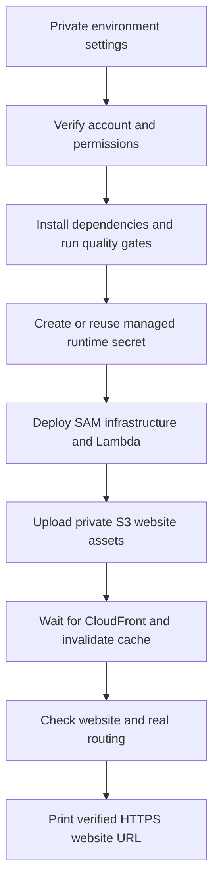

# AWS deployment — one-command release in Northern Virginia

The deployment command targets **`us-east-1` (Northern Virginia)**. After installing the tools, configuring AWS access and filling the environment file, run `npm run deploy:aws`. It validates the project, provisions infrastructure and secrets, publishes the website and checks the deployed endpoints. It does not configure your AWS account or guarantee a zero bill because you have credits.

## 1. What the script deploys



| Component | Configuration |
| --- | --- |
| Website | CloudFront HTTPS URL, private encrypted S3 origin with OAC |
| API | Same-origin `/api/*`, API Gateway HTTP API, no API caching, rate 10/burst 20 |
| Compute | Node.js 24 ARM64 Lambda, default 2,048 MB, 25-second timeout, no VPC |
| Reports | On-demand DynamoDB, point-in-time recovery, retained on stack deletion |
| Photos | Private encrypted S3, 30-day lifecycle, retained on stack deletion |
| Secrets | Tagged Secrets Manager secret created by the script outside the stack |
| Monitoring | 14-day Lambda logs, errors/throttles/duration alarms, SNS email subscription |
| Budget | Account-wide monthly USD cost budget, actual-spend email alerts at 80% and 100% |

The template declares 20 resources; SAM generates additional supporting resources. SAM also manages an artifact bucket. The runtime secret and artifact bucket are not automatically deleted with the application stack. The budget excludes credits/refunds from its cost calculation and includes other workloads in the account. **Alerts are not spending caps.**

Manual prerequisites remain: tool installation, account permissions, AWS login, credit eligibility checks and email subscription confirmation. Custom domains, ACM certificates, Route 53, WAF, account creation, quota increases and existing SQLite-data migration are not automated here. The generated CloudFront hostname works without buying a domain.

## 2. Install tools and configure AWS access

Install Node.js 24+, [AWS CLI v2](https://docs.aws.amazon.com/cli/latest/userguide/getting-started-install.html) and [AWS SAM CLI](https://docs.aws.amazon.com/serverless-application-model/latest/developerguide/install-sam-cli.html). Reopen PowerShell after installation:

```powershell
node --version
npm --version
aws --version
sam --version
```

Docker is not required for this workflow: the repository builds JavaScript directly rather than using a SAM build container.

Use an account-approved IAM role/profile, preferably temporary credentials with MFA. Do not deploy using the AWS root user. If your account uses IAM Identity Center:

```powershell
aws configure sso --profile paanipath
aws sso login --profile paanipath
aws sts get-caller-identity --profile paanipath --region us-east-1
```

Follow the [AWS SSO configuration instructions](https://docs.aws.amazon.com/cli/latest/userguide/cli-configure-sso.html). Your SSO login region can differ from the application's deployment region. If you do not use SSO, configure your approved profile with `aws configure --profile paanipath` or your organization's role tooling. Record the returned 12-digit account ID privately. The script verifies that deployment uses this account and rejects root identities.

Your deployment identity needs permissions for CloudFormation/SAM, its artifact uploads, IAM role creation/pass-role, Lambda, API Gateway, S3 bucket policies, CloudFront, DynamoDB, CloudWatch, SNS and AWS Budgets. It also needs Secrets Manager describe/get/create/put access for `paanipath/<stack-name>/runtime`, including creation tags. Organization SCPs and permission boundaries can still block these actions. The script does not grant itself permissions or alter quotas; ask your account administrator for an approved deployment policy. Lambda receives a separate scoped execution role, not your CLI keys.

Obtain an [OpenRouteService key](https://openrouteservice.org/) with directions and polygon-avoidance access. AWS credits do not pay for ORS or other external map providers. Check their quotas and terms separately.

## 3. Fill the private deployment environment

From the repository root, copy the example only if the private file does not already exist:

```powershell
if (-not (Test-Path -LiteralPath .env.deploy)) {
  Copy-Item -LiteralPath .env.deploy.example -Destination .env.deploy
}
```

Open `.env.deploy` privately and fill the following settings. This file is ignored by Git; `.env.deploy.example` is the safe, blank template to commit.

| Setting | What to enter |
| --- | --- |
| `AWS_ACCOUNT_ID` | Your expected 12-digit account ID |
| `AWS_REGION` | `us-east-1`, the only supported region in this release script |
| `AWS_PROFILE` | Your configured profile, e.g. `paanipath`; default example is `default` |
| `DEPLOY_STACK_NAME` | Stable unique name, e.g. `paanipath-ncr`, 1–32 characters starting with a letter |
| `DEPLOY_ALERT_EMAIL` | Real email address for operational and budget alerts |
| `DEPLOY_MONTHLY_BUDGET_USD` | Positive monthly account-wide budget amount, default `10` |
| `DEPLOY_APPROVED` | Change to `true` only when ready to create billable resources and IAM roles |
| `DEPLOY_RESERVED_CONCURRENCY` | Default `0` means omit reserved concurrency, not disable Lambda |
| `DEPLOY_MEMORY_MB` | Default `2048`; allowed 128–10240, subject to AWS account quotas |
| `ORS_API_KEY` | Your server-only directions key; required |
| `ORS_URL` | Keep the supplied directions HTTPS endpoint unless using an approved compatible provider |
| `PHOTON_URL` | Keep the supplied geocoding HTTPS endpoint unless using your own service |
| `SESSION_SECRET` | Leave blank to securely generate once and reuse, or provide a stable secret of 32+ characters |
| `SEED_MODE` | `true` for the 500-hotspot / 6,505-case simulated demo, `false` for community-only use |
| `DEMO_MODE` | `true` enables clearly labelled seed-refresh controls; normally disable outside demos |
| `DEPLOY_SMOKE_ROUTE` | `true` checks Journey 1 against live ORS after deployment and consumes provider quota |
| `AWS_ACCESS_KEY_ID`, `AWS_SECRET_ACCESS_KEY`, `AWS_SESSION_TOKEN` | Optional temporary credentials instead of a profile; leave all blank when using a profile |

If supplying credentials in this file, clear `AWS_PROFILE`, supply both access-key fields and include the session token when required. Otherwise leave all credential fields blank. Explicit profile configuration takes precedence over inherited access-key variables. Avoid long-lived keys when temporary credentials are available.

New accounts can have low Lambda concurrency quotas. Leaving reserved concurrency at `0` avoids requesting a reservation. A positive reservation requires quota headroom for AWS's unreserved pool; other functions' reservations can also cause deployment failure. See [Lambda concurrency](https://docs.aws.amazon.com/lambda/latest/dg/lambda-concurrency.html). The preflight checks total quota, not every existing allocation. API throttles and budgets do not impose an account-wide cost cap.

Protect `.env.deploy` with your computer's file permissions. Git ignore rules are not encryption. Do not put keys in screenshots, documentation, shell transcripts or support tickets. The deployer rejects unknown setting names to catch misspellings.

## 4. Preview, then run once

The preview validates configuration without contacting AWS or creating files/resources:

```powershell
npm run deploy:aws -- --plan
```

After filling the required fields and setting `DEPLOY_APPROVED=true`:

```powershell
npm run deploy:aws
```

You do not need to manually build or upload anything. The command performs these steps:

1. Check AWS CLI v2/SAM, account identity, stack ownership/status and Lambda concurrency quota.
2. Run `npm ci --ignore-scripts`, the complete `npm run check` suite and HTTP integration tests.
3. Run `sam validate --lint` against the template before creating secrets or application resources.
4. Create/reuse the tagged runtime secret. A temporary ignored JSON file supplies secret values, not plaintext command-line arguments; the file is removed in a `finally` block.
5. Run non-interactive SAM deployment with IAM capability acknowledgment, managed artifact uploads and version-pinned secret references. Empty change sets succeed. A generated private SAM configuration isolates the command from unrelated local defaults.
6. Validate stack outputs and upload `dist/web` to the matching private bucket. JavaScript/CSS and other assets receive explicit MIME types; the manifest, service worker and HTML entry point are uploaded last with revalidation headers. No public ACL or broad `--delete` operation is used.
7. Wait for CloudFront deployment, invalidate cached paths and wait for invalidation completion.
8. Save non-secret stack outputs to ignored `.deploy/outputs.json`.
9. Check API health, bootstrap/journey catalogue, required web assets and optional real Journey 1 routing. This smoke test does not submit incidents or photos.
10. Print the verified HTTPS URL and the remaining email/browser checks.

First deployment can take tens of minutes, especially while CloudFront propagates. Individual tool commands have a 60-minute timeout; AWS waiters can fail earlier. Do not assume a closed terminal or failed smoke test means resources were rolled back. Inspect CloudFormation before retrying.

Seeds initialize in the cloud store when the API is first read with `SEED_MODE=true`. Your local `.data` files are never uploaded. Existing cloud community reports are preserved by the catalogue reconciliation logic. Routes still require live provider access.

## 5. Finish the manual acceptance checks

- Confirm the **SNS email subscription** using the email AWS sends. Until confirmed, operational notifications cannot reach that address. Check spam and verify budget emails too.
- In Billing, verify credit balance, eligible services, expiry and the account-wide budget. Check provider dashboards separately.
- Open the printed URL. Startup should have blank A/B fields, an NCR viewport and no hotspots. Choose Journey 1–10 and verify route animation, route cards, nearby hotspots, counts and View cases.
- Check search, added/reordered stops, different vehicles, mobile layouts, keyboard navigation, touch gestures, tile attribution and error states. HTTP smoke tests do not prove visual/device behavior.
- For an aged demo, use **How it works → Refresh seeds** with demo mode enabled. This refreshes simulations, not live incident evidence, and preserves community reports.
- Test report/photo persistence in a separate staging stack, not by adding fake incidents to a live community deployment.

This is a serverless pilot, not a production security certification. The raw API Gateway URL remains publicly reachable. Add appropriate authentication/moderation, direct API protection, shared provider-quota controls and contracted tile/geocoding capacity before broad public use. Never present simulated observations or recommendations as guaranteed road safety.

## 6. Redeploy and rotate secrets

Run the same command with the same account/profile/stack name for subsequent releases. Only stacks and runtime secrets tagged as owned by this deployer are reused; it refuses to adopt an unrelated existing stack or secret automatically.

Leave `SESSION_SECRET` blank to reuse the generated secret. Supplying a new session secret invalidates existing anonymous session signatures, so rotate deliberately. Changing `ORS_API_KEY` creates a new secret version and updates the Lambda configuration through a version-pinned CloudFormation reference. The private environment file is the desired ORS-key source; manual changes to that secret can be overwritten on the next deploy.

Secret values are resolved into Lambda environment variables at deployment. There is no runtime Secrets Manager fetch, and an identity allowed to read Lambda configuration can access these values. Secret changes alone do not automatically refresh Lambda: this script changes the version reference when needed. See [CloudFormation secret references](https://docs.aws.amazon.com/AWSCloudFormation/latest/UserGuide/dynamic-references-secretsmanager.html), [secret versions](https://docs.aws.amazon.com/cli/latest/reference/secretsmanager/put-secret-value.html) and [SAM deploy options](https://docs.aws.amazon.com/serverless-application-model/latest/developerguide/sam-cli-command-reference-sam-deploy.html).

The secret is outside the application stack and remains after stack deletion. Temporary payloads use restrictive POSIX modes where supported; on Windows, inherited NTFS permissions apply. A forcibly terminated process can leave a payload in `.deploy/private`; inspect that specific directory privately and remove leftover payload files before sharing the computer. Do not publish `.deploy`.

## 7. Costs, monitoring and failure recovery

The monthly budget is account-wide, not isolated to this stack. Its calculation excludes credits/refunds so credits do not hide underlying spend. Actual-spend notices at 80% and 100% are warnings, not automatic shutdown. Consult [AWS Budgets configuration](https://docs.aws.amazon.com/AWSCloudFormation/latest/TemplateReference/aws-resource-budgets-budget.html) and actual Billing usage; credit eligibility and current pricing remain your responsibility.

Lambda alarms detect at least one error/throttle in a five-minute period and a maximum duration of at least 22 seconds. They are basic pilot alerts, not complete observability. Inspect CloudFormation events, Lambda logs, SNS subscriptions, CloudFront status and provider quotas when diagnosing failures.

| Failure | What to do |
| --- | --- |
| Tool missing | Install AWS CLI v2/SAM/Node 24 and reopen PowerShell |
| Wrong account or expired login | Correct the profile/account ID or renew temporary credentials/SSO |
| Access denied | Review the failed operation with your administrator, including SCPs and pass-role permissions |
| Unmanaged existing stack/secret | Use a new stack name or have the owner review it; the script does not delete/adopt it |
| Lambda quota/memory restriction | Review Service Quotas in `us-east-1`; keep reservation at 0 unless approved |
| CloudFormation failed/rollback state | Inspect Events first; resolve the cause using AWS guidance before rerunning |
| ORS smoke fails | Check provider credentials/quota/network/plan limits; infrastructure can already be deployed |
| Upload or CloudFront waiter fails | Inspect the distribution/stack, then rerun after resolving the cause |
| Website MIME/cache error | Review S3 object metadata and invalidation; rerun publication through this script |
| Alerts absent | Confirm SNS subscription and check the budget recipient/settings |
| Interrupted command | Inspect AWS state and private temporary files before retrying |

The script stops on errors and does not automatically destroy resources. Frontend/backend publication is not an atomic blue/green release; uploading entry points last reduces, but does not eliminate, mixed-version risk. To recover application code, restore a known good revision, configure the same stack and redeploy after reviewing infrastructure compatibility. Retained DynamoDB, photos, runtime secrets and artifact storage can continue accruing costs after stack deletion. Plan backups, cleanup and any destructive action explicitly.

## 8. What to commit to GitHub

Commit this guide, `.env.deploy.example`, `apps/deploy`, `scripts/deploy.mjs`, the template, tests, package files and associated public documentation. They contain no account-specific credentials. Keep `.env.deploy`, `.env`, `.deploy`, AWS credential files, `.data`, build outputs and local SAM configuration ignored.

```powershell
git check-ignore .env.deploy .deploy/outputs.json
git status --short
git diff --cached --check
```

Inspect the actual staged diff for secrets before committing. The older ignored `prepare-commits.ps1` helper has a fixed file plan and may need updating for these new deployment files; it is not the deployment script. Deployment itself never commits or pushes to GitHub.
